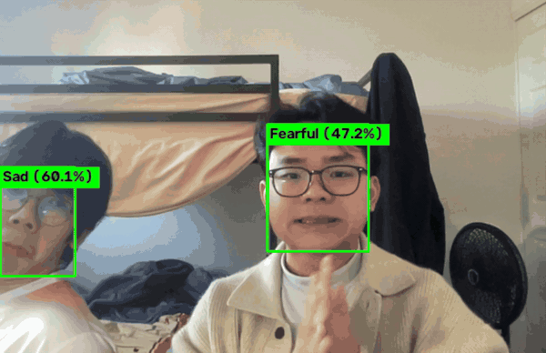

# Real-Time Human Emotion Detection Pipeline

A two-stage pipeline that detects faces in a live webcam feed and classifies their emotion using a classifier built from scratch — no scikit-learn, no pre-built classifiers, and every evaluation metric implemented by hand.

<!--
  TODO: add a demo GIF here once recorded.
  Record 15-30s of `python FaceDetection.py` with labels overlaid, save to docs/demo.gif, then uncomment:

  
-->

---

## Project Goal

Classify facial emotion from a live webcam feed into one of **7 classes**:

> Angry, Disgusted, Fearful, Happy, Sad, Surprised, Neutral

---

## Results

Evaluated across 5 stratified 70/15/15 train/val/test splits.

| Metric | Value |
|---|---|
| Mean test accuracy | 73.5% |
| Classes | 7 |
| Chance baseline | ~14% |

Per-split confusion matrices (train/val/test), training curves, and accuracy comparisons are in `results_iter1/` through `results_iter5/`.

`FaceDetection.py` loads `models/emotion_model_iter2.pth` for live inference — the weights from split 2.

---

## Architecture


```
Webcam Frame
     │
     ▼
┌──────────────────────────┐
│ Stage 1: Face Detection  │  YOLOv11n (Hugging Face)
│ AdamCodd/YOLOv11n-face   │  → Bounding box coords
└──────────────────────────┘
     │
     ▼  Crop + Resize to 224×224 + Normalize
     │
┌───────────────────────────────┐
│ Stage 2a: Feature Extraction  │  ViT-B/16 (google/vit-base-patch16-224-in21k)
│ CLS token → 768-dim vector    │  frozen weights
└───────────────────────────────┘
     │
     ▼
┌───────────────────────────────────┐
│ Stage 2b: Emotion Classification  │  Custom logistic regression
│ W (768×7) + b (7,) → Softmax      │  trained with L-BFGS
└───────────────────────────────────┘
     │
     ▼
Emotion Label + Confidence overlaid on frame
```

---

## Repository Layout

| File | Purpose |
|------|---------|
| `FaceDetection.py` | Live webcam entry point (runs on the host, not in Docker) |
| `predict.py` | Image-file entry point — prints each detected face's emotion and confidence; the Docker entrypoint |
| `Dockerfile` | CPU image for `predict.py` |
| `pyproject.toml`, `uv.lock` | Dependencies, managed with [uv](https://docs.astral.sh/uv/) |
| `Feature_Extracting.py` | `ViTFeatureExtractor` — batch-extract 768-dim feature vectors from images |
| `prepare_data.py` | Merge emotion CSVs, stratified split into 5 train/val/test iterations |
| `Training.py` | Train, evaluate, and visualize the classifier |
| `NewtonMethod.py` | `CustomLogisticRegression` — PyTorch implementation using L-BFGS |
| `Modify_csv.py` | CSV preprocessing helper |
| `pipeline.py` | Generate the Graphviz architecture diagram (`pipeline_architecture.png`) |
| `models/` | Trained weights, one per split |
| `results_iter1..5/` | Confusion matrices and training curves per split |

---

## Setup

Requires [uv](https://docs.astral.sh/uv/getting-started/installation/) and Python 3.11 or 3.12.

```bash
uv sync
```

Run scripts inside the environment with `uv run`, e.g. `uv run python FaceDetection.py`.

`pipeline.py` additionally needs the Graphviz **binary**, which is separate from the Python package: https://graphviz.org/download/

### Hardware

`uv.lock` pins the **CPU-only** build of PyTorch, which keeps installs and the Docker image small. ViT inference on CPU is slower than on a GPU; using a CUDA GPU means changing the `pytorch-cpu` index in `pyproject.toml` and re-locking.

---

## Usage

### 1. Extract features from your dataset

```bash
python Feature_Extracting.py
```

Produces one CSV per emotion (e.g. `vit_happy_features.csv`), each row a 768-dimensional feature vector.

### 2. Prepare training data

```bash
python prepare_data.py
```

Merges the per-emotion CSVs and creates 5 stratified splits, each with its own random seed:

```
iteration_1/
    train_features.csv   # 70%
    val_features.csv     # 15%
    test_features.csv    # 15%
iteration_2/ ...
```

### 3. Train the classifier

```bash
python Training.py
```

Trains `CustomLogisticRegression` on each split with L-BFGS, then writes:

- `models/emotion_model_iter{n}.pth` — trained weights
- `results_iter{n}/` — confusion matrices, training history, accuracy comparison

### 4. Run live detection

```bash
python FaceDetection.py
```

Opens the default webcam. Press **`q`** to quit.

On startup it loads the YOLOv11n face detector (downloaded from Hugging Face on first run), the ViT-B/16 feature extractor, and `models/emotion_model_iter2.pth`. Step 3 must have run at least once, or the weights file will be missing.

This runs on the host, **not** in Docker (see below).

---

## Run with Docker

The Docker image predicts emotions from an **image file**. It does not do live webcam inference.

**Live webcam inference (`FaceDetection.py`) must run on the host.** On macOS and Windows, containers run inside Docker Desktop's Linux VM, which has no access to the host camera and no display for `cv2.imshow`.

Build the image:

```bash
docker build -t emotion-detection .
```

Predict on the bundled test image:

```bash
docker run --rm emotion-detection
```

Predict on your own image by mounting it into the container:

```bash
docker run --rm -v "$PWD/some.jpg:/app/in.jpg" emotion-detection in.jpg
```

On Windows PowerShell, use `"${PWD}\some.jpg:/app/in.jpg"` for the mount.

The container prints one line per detected face, in the format `face <n>: <Emotion> (<confidence>%) box=[x1,y1,x2,y2]`, or `No face detected.` if there is none. It exits with code 2 if the image cannot be read.

The first run downloads about 350 MB of model weights from Hugging Face. To cache them across runs, mount a named volume:

```bash
docker run --rm -v hf-cache:/app/.cache/huggingface -v "$PWD/some.jpg:/app/in.jpg" emotion-detection in.jpg
```

The image is CPU-only.

---

## Model Details

### Feature extractor — ViT-B/16

- Model: `google/vit-base-patch16-224-in21k`
- Input: 224×224 RGB
- Output: 768-dimensional CLS token embedding
- Weights are **frozen** — used purely as a feature extractor, never fine-tuned

### Classifier — custom logistic regression

- Implemented from scratch in PyTorch, without `nn.Module` or scikit-learn
- Parameters: weight matrix `W` (768×7) and bias `b` (7,)
- Optimizer: **L-BFGS**, a quasi-Newton method — it approximates the inverse Hessian from gradient history rather than computing it directly (`torch.optim.LBFGS`)
- Loss: cross-entropy
- Accuracy, precision, recall, F1 and confusion matrices are all computed manually

### Data splits

- 70% train / 15% validation / 15% test
- Stratified to preserve class balance, repeated across 5 seeds to check stability

---

## Built With

- **Face detection:** YOLOv11 (Ultralytics), via Hugging Face Hub
- **Feature extraction:** Vision Transformer ViT-B/16 (Hugging Face Transformers)
- **Classification:** PyTorch — custom logistic regression trained with L-BFGS
- **Image processing:** OpenCV, Pillow
- **Data:** pandas, NumPy
- **Visualization:** Matplotlib, Graphviz

---

## License

MIT — see [LICENSE](LICENSE).
